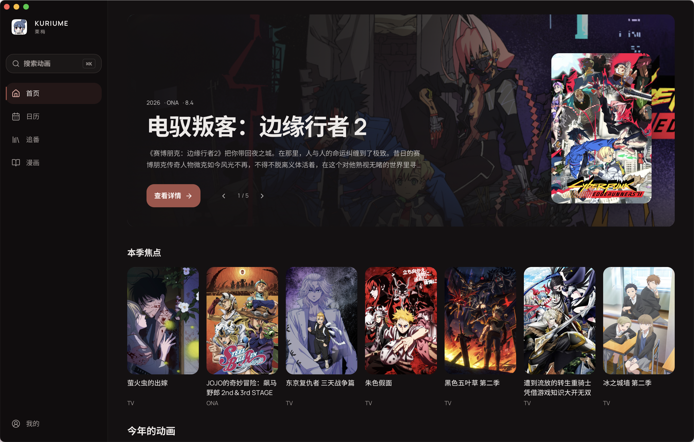
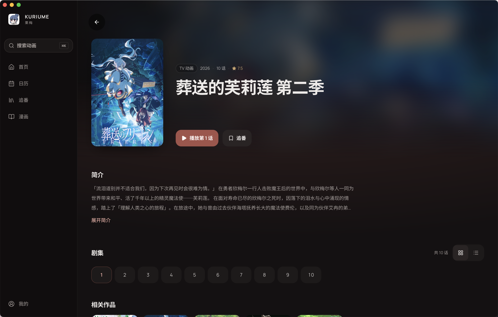
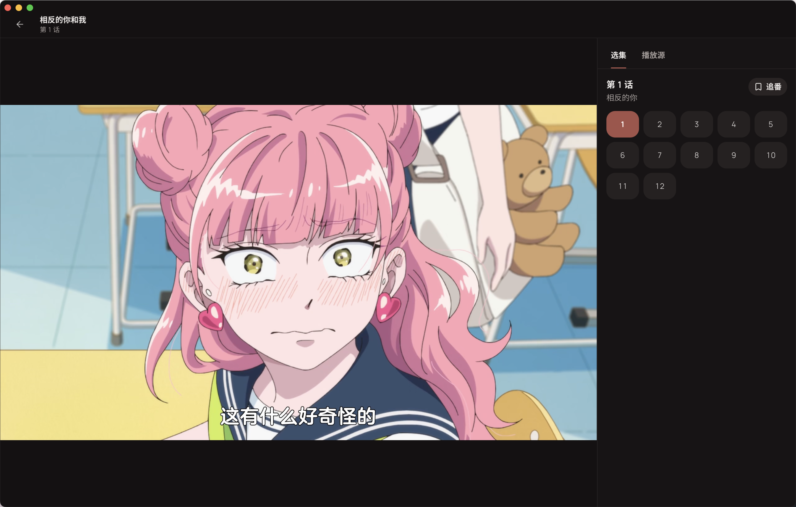
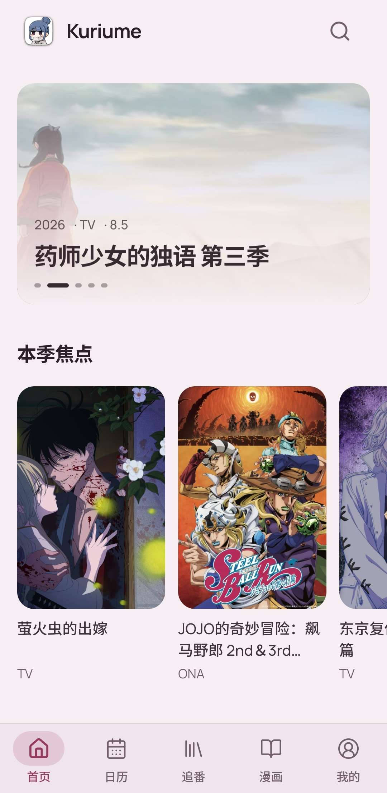
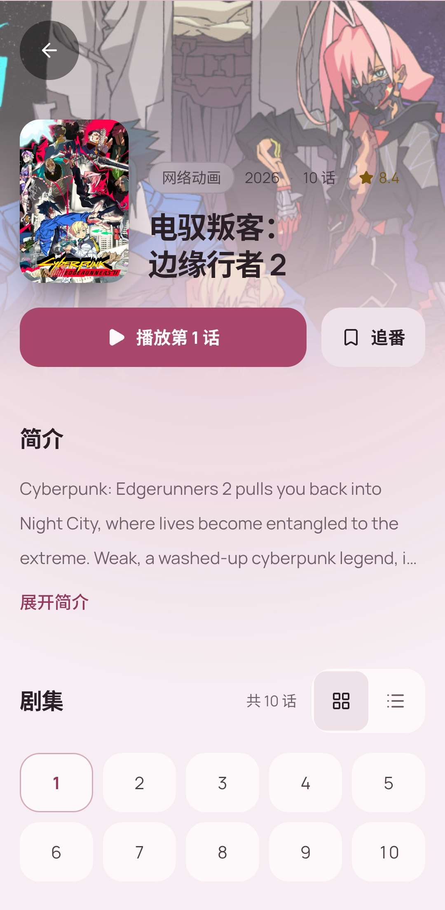
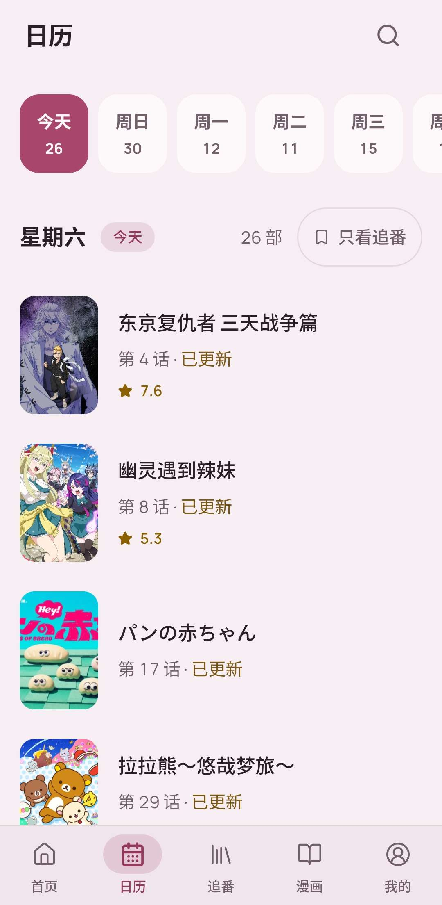
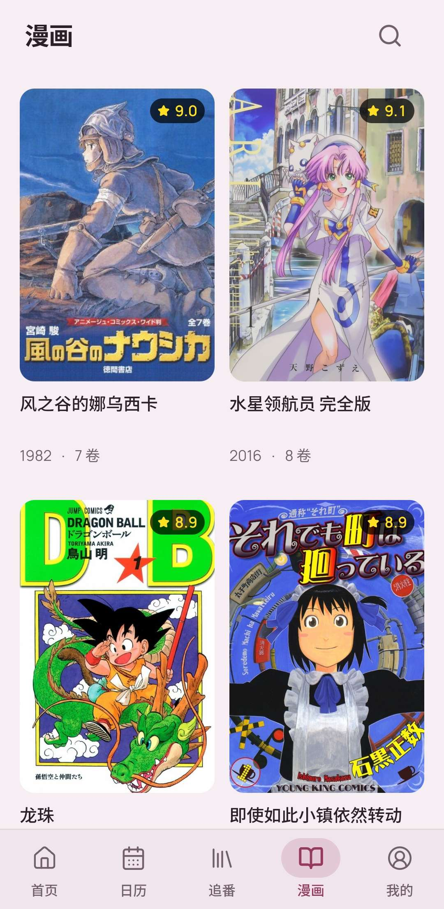
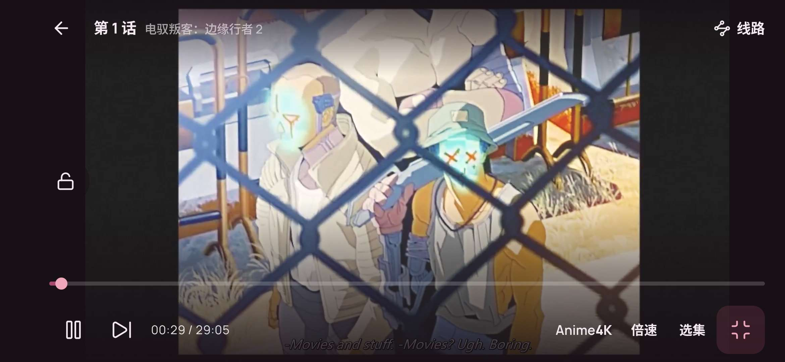

<h4 align="right"><strong>English</strong> | <a href="README_CN.md">简体中文</a></h4>

  

<h1 align="center">Kuriume · 栗梅</h1>

An anime aggregation, parsing and playback app

  
  
  

  

## What it is

Kuriume brings anime and manga together in one app.

It started from a wish to gather a scattered way of watching anime into one place. Following a show usually means hopping between several sites and apps: one for the season's schedule, another to find something to stream, and a separate note of which episode you were on. Kuriume puts all of that in one quiet interface, so what to watch, where to watch it and how far you've got all live in the same place. On a computer or a phone, you follow your shows the same focused way and keep your attention on the shows themselves.

There is no account to create and nothing to set up. Your list and watch history stay on your own device.

## The name

  

Kuriume is the reading of 栗梅 (くりうめ), a traditional Japanese colour. The plum (梅) in its name blossoms at the end of winter, before almost any other flower, and in the Japanese language of flowers it stands for nobility, faithfulness and endurance. I love this colour, so it became the app's name and its default theme colour.

## Screenshots

<table>
  <tr>
    <td width="50%"></td>
    <td width="50%"></td>
  </tr>
  <tr>
    <td align="center">Details</td>
    <td align="center">Player</td>
  </tr>
</table>

<table>
  <tr>
    <td width="25%"></td>
    <td width="25%"></td>
    <td width="25%"></td>
    <td width="25%"></td>
  </tr>
  <tr>
    <td align="center">Home</td>
    <td align="center">Details</td>
    <td align="center">Schedule</td>
    <td align="center">Manga</td>
  </tr>
</table>

  
   
  Watching on a phone in landscape

## Download

Get the package for your device from [Releases](https://github.com/Twacqwq/Kuriume/releases/latest).

| Platform | Download | Notes |
|----------|----------|-------|
| macOS | `.dmg` | For Macs with Apple silicon |
| Windows | `.exe` or `.msi` | 64-bit Windows |
| Android | `.apk` | Install it directly |
| iOS | `.ipa` | Unsigned; install it with a sideloading tool |

## FAQ

**macOS says the app can't be opened.**
Kuriume isn't notarized by Apple yet. Try opening it once, then go to System Settings › Privacy & Security and choose **Open Anyway** near the bottom.

**Some shows have no stream that plays.**
Streams come from public video sites, so a brand-new episode or a lesser-known show may not be available yet. Try another source on the player page, or check back later.

**Where is my list stored?**
Only on your device. Kuriume has no server and uploads nothing. Moving to a new device currently means adding your shows again.

## Coming next

- [ ] Manga reading from Komga, OPDS libraries and local files

## Contributing

Issues and pull requests are welcome. See [CONTRIBUTING.md](CONTRIBUTING.md) for the development setup.

## Disclaimer

Kuriume does not store or upload any video; playback comes from third-party public sites. Only use content you are legally allowed to access where you live.

## Thanks

**Data**
- [AniList](https://anilist.co/) and [Bangumi](https://bgm.tv/) for show information, schedules and synopses
- [soruly/anilist-chinese](https://github.com/soruly/anilist-chinese) for Chinese titles of AniList works
- The [弹弹play open danmaku network](https://www.dandanplay.com/) for danmaku comments during playback

**Artwork**
- App icon by [ゆきうなぎ](https://www.pixiv.net/artworks/138196800) on Pixiv
- Launch wallpaper by [Nanami](https://in.pinterest.com/pin/1030128114790424225) on Pinterest

**Picture enhancement**
- [Anime4K](https://github.com/bloc97/Anime4K) and [Anime4K-WebGPU](https://github.com/Anime4KWebBoost/Anime4K-WebGPU)

**Fonts**
- [Manrope](https://github.com/sharanda/manrope) and [Noto Sans SC](https://github.com/notofonts/noto-cjk)

**Open-source projects**

| Project | License | Project | License |
|---------|---------|---------|---------|
| [Tauri](https://tauri.app/) | MIT / Apache-2.0 | [tokio](https://tokio.rs/) | MIT |
| [React](https://react.dev/) | MIT | [reqwest](https://github.com/seanmonstar/reqwest) | MIT / Apache-2.0 |
| [TanStack](https://tanstack.com/) | MIT | [serde](https://serde.rs/) | MIT / Apache-2.0 |
| [ArtPlayer](https://artplayer.org/) | MIT | [rusqlite](https://github.com/rusqlite/rusqlite) | MIT |
| [hls.js](https://github.com/video-dev/hls.js/) | Apache-2.0 | [scraper](https://github.com/rust-scraper/scraper) | ISC |
| [Tailwind CSS](https://tailwindcss.com/) | MIT | [zhconv](https://github.com/Gowee/zhconv-rs) | GPL-2.0-or-later |
| [Radix UI](https://www.radix-ui.com/) · [shadcn/ui](https://ui.shadcn.com/) | MIT | [uuid](https://github.com/uuid-rs/uuid) | MIT / Apache-2.0 |
| [Lucide](https://lucide.dev/) | ISC | [hyper](https://hyper.rs/) | MIT |
| [Vaul](https://github.com/emilkowalski/vaul) | MIT | [ring](https://github.com/briansmith/ring) | Apache-2.0 + ISC |

Anime4K and Anime4K-WebGPU are MIT licensed; Manrope and Noto Sans SC use the SIL Open Font License 1.1.

## License

[GNU General Public License v3.0](LICENSE)
